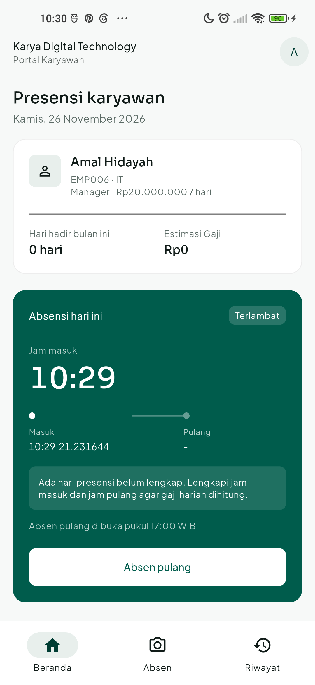
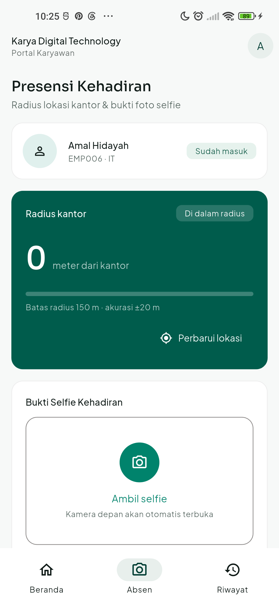
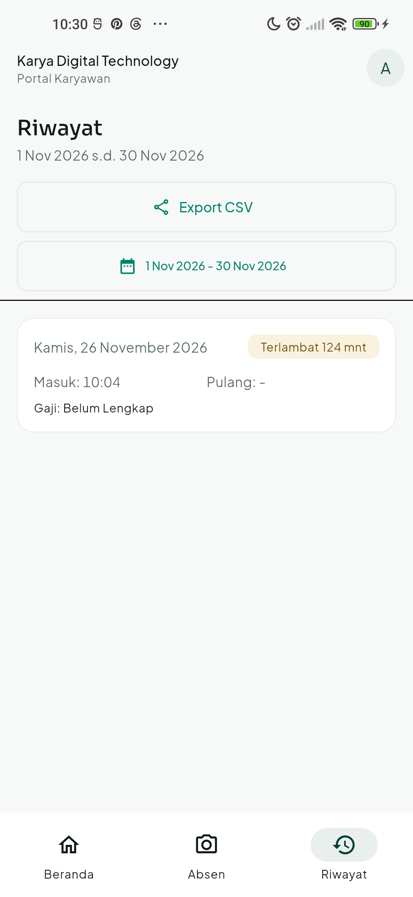
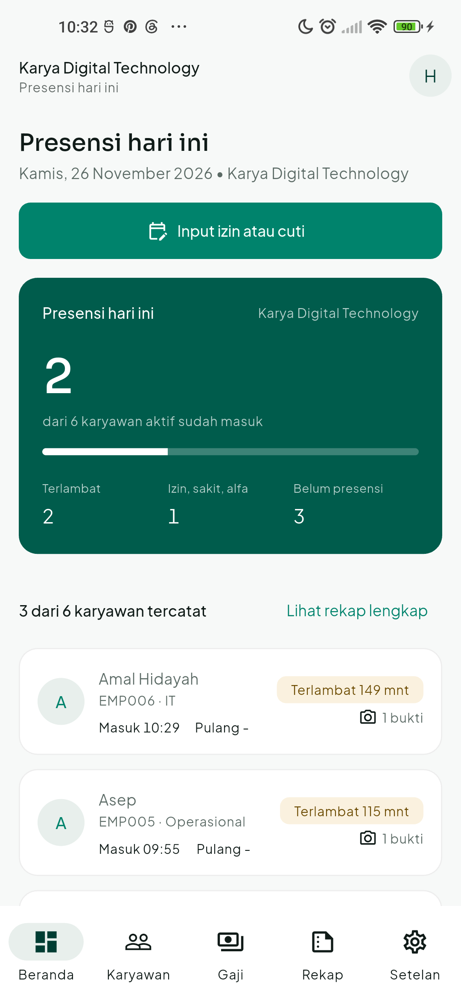
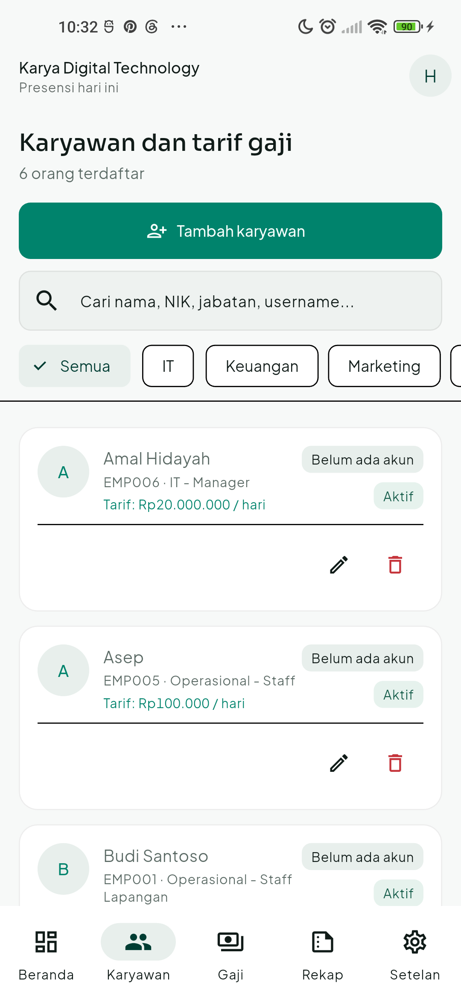
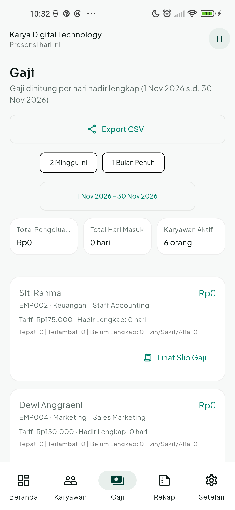
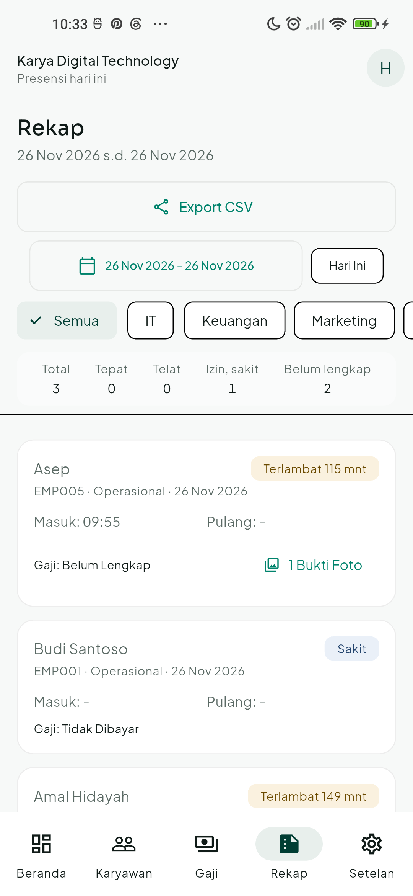
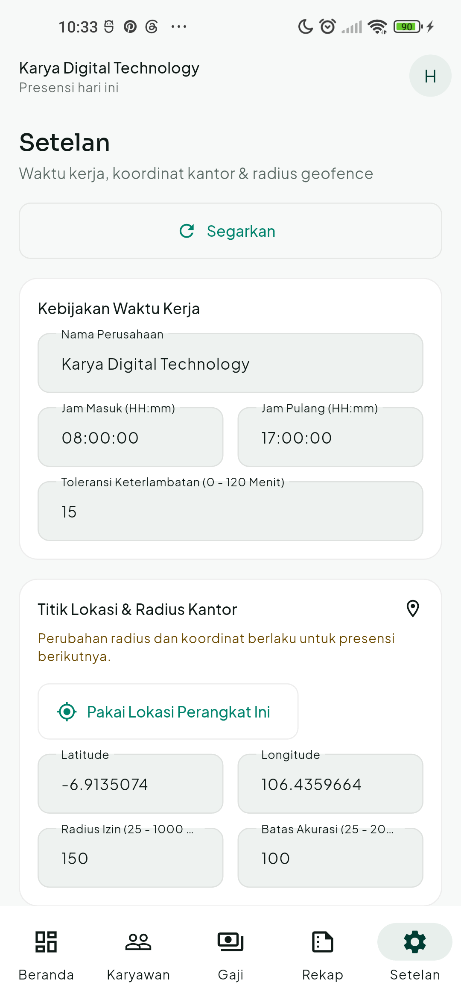
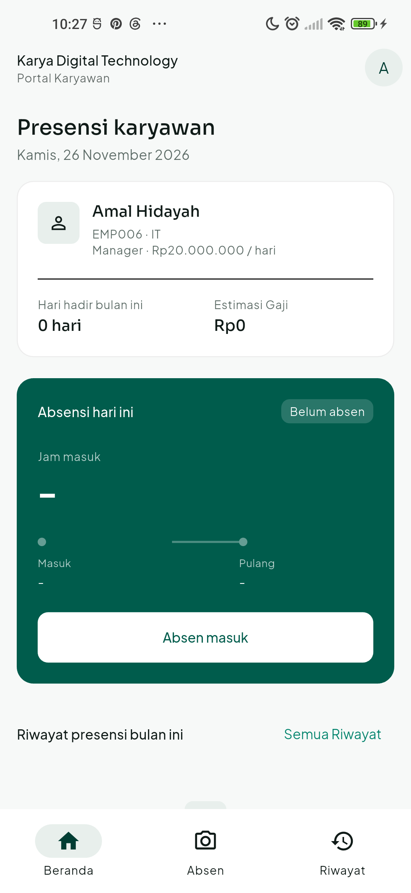

# AbsenGo — Presensi Karyawan & Penggajian Harian

**Tema:** tertib, cepat, lapangan — gerbang kantor dan jam kerja.

Tema ini dipilih karena absensi terjadi di gerbang, bukan di meja kerja: karyawan butuh satu tindakan yang jelas dan selesai dalam beberapa detik. Permukaan netral dengan aksen teal menjaga layar tetap tenang saat dipakai di terang hari, sementara jam dan jarak memakai angka tabular supaya mudah dibaca sekilas. Sora untuk judul dan Plus Jakarta Sans untuk isi memberi kesan operasional tanpa berubah menjadi tampilan korporat yang kaku.

## Pemetaan model

| Model | Peran | Fungsi di aplikasi |
| --- | --- | --- |
| `Employee` | Data utama | Identitas, divisi, jabatan, tarif harian, dan status aktif karyawan. Menjadi sumber daftar karyawan, rekap, dan gaji. |
| `Attendance` | Data utama | Catatan kehadiran per tanggal: jam masuk, jam pulang, status, dan keterlambatan. Menentukan apakah suatu hari dihitung sebagai upah. |
| `AttendanceEvidence` | Data aksi | Jejak setiap aksi absen: foto selfie, koordinat, akurasi GPS, jarak ke kantor, dan flag lokasi palsu. |
| `LoginAccount` | Data aksi | Pemetaan username ke akun Auth, peran, dan karyawan. Baris ini dibuat atau diubah lewat aksi admin pada Edge Function. |
| `CompanySettings` | Data informasi | Nama perusahaan, jam masuk/pulang, toleransi terlambat, titik kantor, radius, dan batas akurasi. Dibaca sebelum absen diterima. |
| `UserProfile` | Data informasi | Gabungan akun Auth, `LoginAccount`, dan `Employee` untuk sesi berjalan; menentukan panel admin atau karyawan. |

Data utama adalah objek yang dikelola setiap hari. Data aksi adalah hasil dari tindakan pengguna. Data informasi adalah konteks yang dibaca supaya keputusan di layar benar.

## Fitur buatan sendiri

- **Kamera selfie in-app.** Tombol absen membuka preview kamera depan di dalam aplikasi, bukan galeri. Foto dikompres ke maksimal 1080 px dengan batas 5 MB sebelum diunggah.
- **Gerbang digital.** Absen hanya diterima jika GPS berada dalam radius kantor, akurasi sesuai batas, dan lokasi bukan hasil mock.
- **Aturan jam di server.** `record_attendance_geo` memanggil `absengo_record_clock` sehingga masuk/pulang, toleransi terlambat, dan gaji dihitung di database, bukan di perangkat.
- **Akun karyawan oleh admin.** Edge Function `manage-employee-account` membuat akun Auth, baris karyawan, dan baris login sekaligus; signup publik tetap mati.
- **Panel terbagi.** Karyawan melihat 3 tab: Beranda, Absen, Riwayat. Admin melihat 5 tab: Beranda, Karyawan, Gaji, Rekap, Setelan.
- **Penggajian harian.** Gaji dihitung dari hari yang lengkap (masuk dan pulang) dikali tarif harian; rekap bisa diekspor ke CSV.

## Screenshot

Screenshot diambil dari APK release yang dipasang di HP melalui kabel USB.

### Tab karyawan

- **Beranda** — ringkasan profil, jam masuk, dan riwayat terbaru.

  

- **Absen** — status radius lokasi dan bukti selfie.

  

- **Riwayat** — presensi bulanan beserta status dan gaji.

  

### Tab admin

- **Beranda** — ringkasan kehadiran hari ini dan daftar karyawan yang sudah presensi.

  

- **Karyawan** — daftar karyawan, divisi, dan tarif gaji harian.

  

- **Gaji** — estimasi upah per periode berdasarkan hari hadir lengkap.

  

- **Rekap** — catatan presensi per tanggal beserta statusnya.

  

- **Setelan** — jam kerja, titik lokasi kantor, radius geofence, dan batas akurasi.

  

### Beranda sebelum dan sesudah presensi tercatat

| Kondisi | Tampilan | Screenshot |
| --- | --- | --- |
| Sebelum | Status `Belum absen`, jam masuk `-`, belum ada riwayat bulan ini. |  |
| Sesudah | Status `Terlambat`, jam masuk `10:29`, bukti selfie tersimpan, dan riwayat bulan ini muncul. |  |

## Hasil `flutter test`

```text
00:00 +0: loading C:/Users/MY THINKPAD/Documents/Absen Go Mobile/test/widget_test.dart
00:00 +0: Core Utilities Test CurrencyFormat formats Indonesian Rupiah correctly
00:00 +1: Core Utilities Test JakartaTime preset 2 minggu dan 1 bulan return valid dates
00:00 +2: Core Utilities Test CsvGenerator builds valid UTF-8 BOM CSV with escaped quotes
00:00 +3: Widget Tests StatusBadge renders correctly with contrast compliant styling
00:01 +4: Widget Tests LoginScreen renders username, password, and submit button
00:02 +5: All tests passed!
```

Lima pengujian lulus, tanpa kegagalan.

## Menjalankan proyek

```sh
flutter pub get
flutter run
```

Untuk APK:

```sh
flutter build apk --release
```

Konfigurasi Supabase ada di `lib/app/env.dart`. Jalankan satu file SQL di `schema database/paste di sql project baru.sql` pada Supabase SQL Editor, deploy `manage-employee-account`, lalu pastikan **Allow new users to sign up** dimatikan. Kunci secret hanya dipakai Edge Function dan tidak pernah ditaruh di kode Flutter.

Dibangun dengan Flutter, Riverpod, GoRouter, Supabase, geolocator, dan camera.
